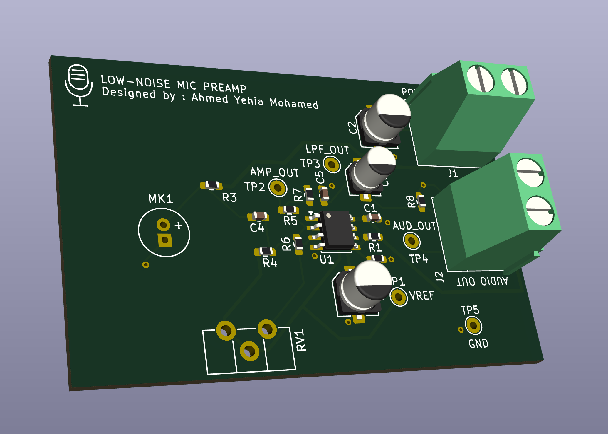
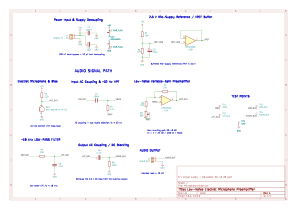
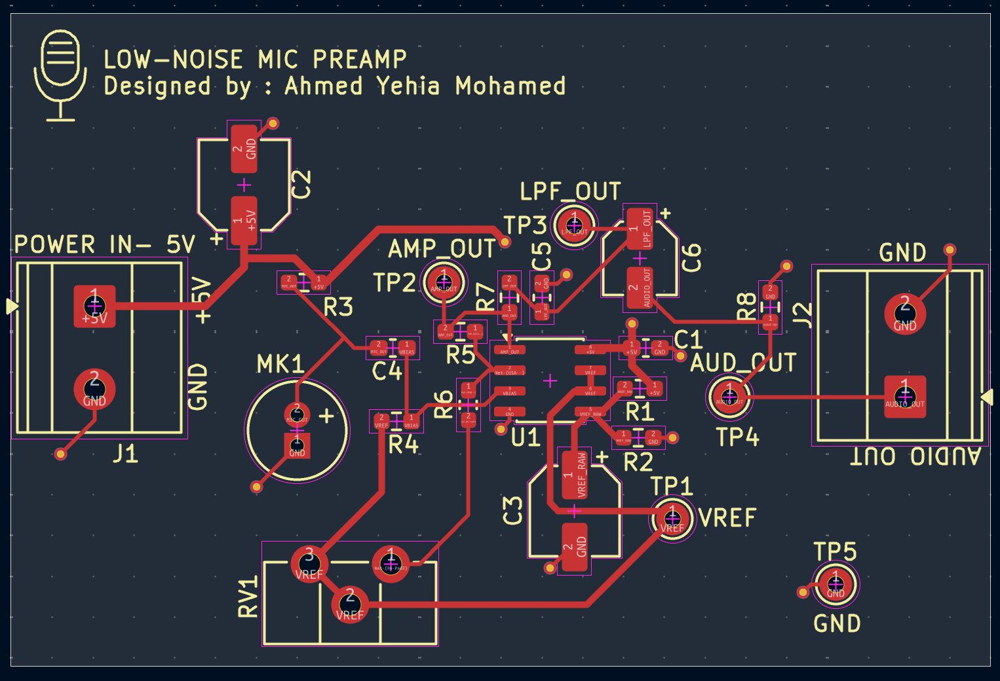
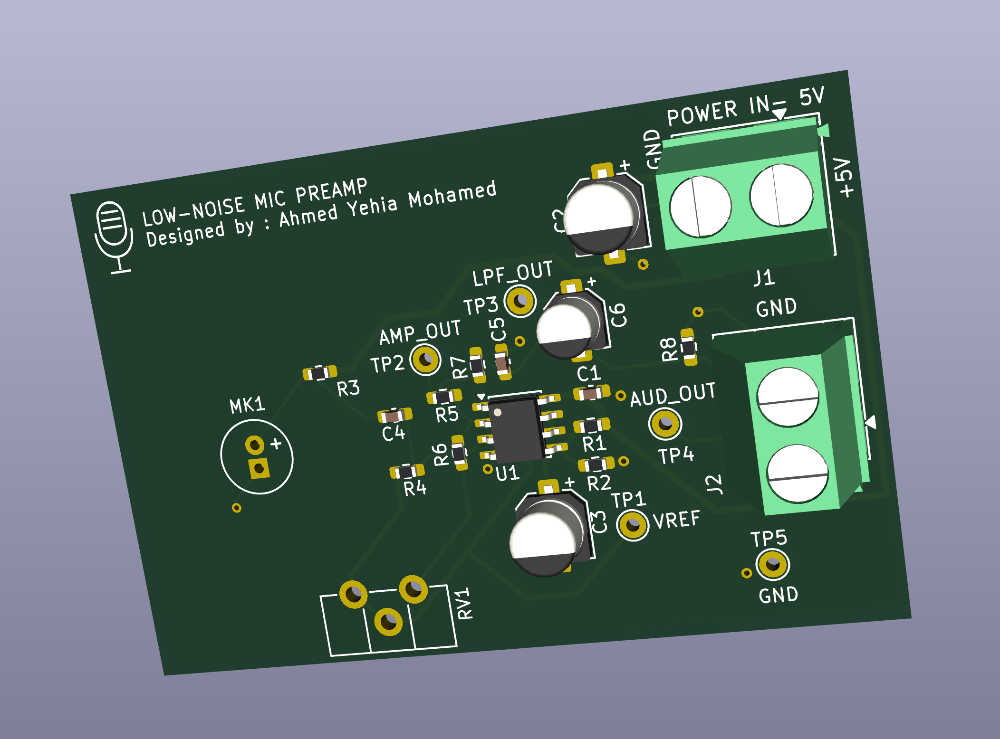
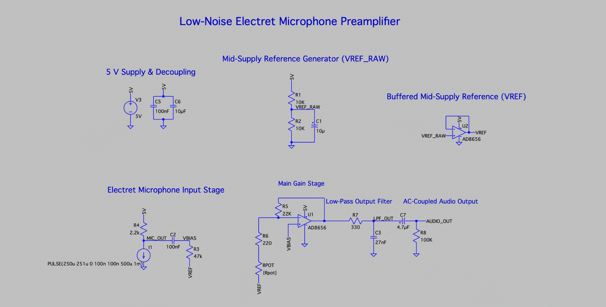
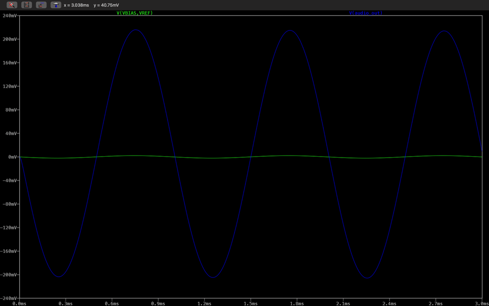
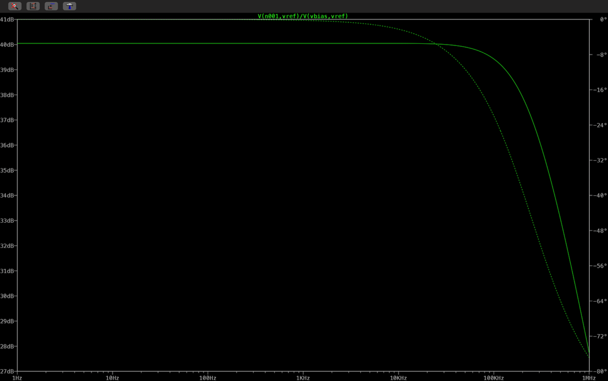
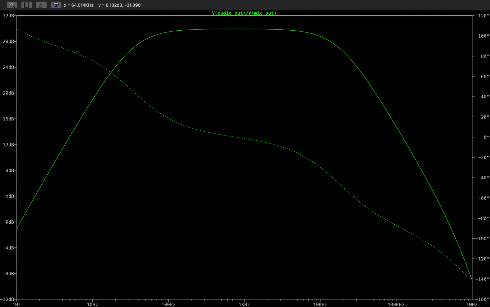
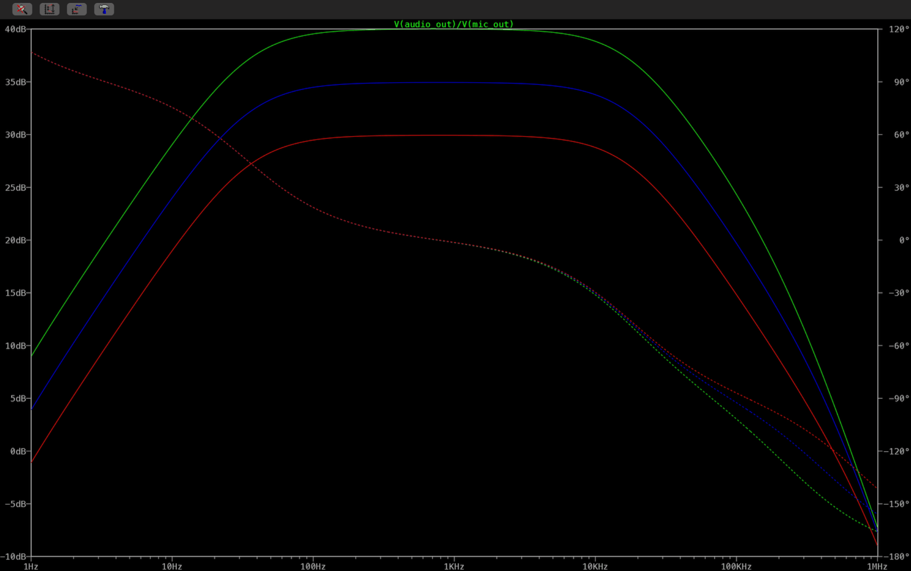
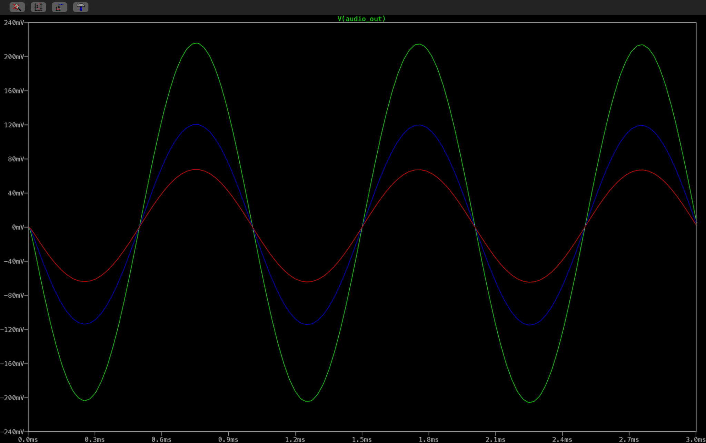

# Low-Noise Electret Microphone Preamplifier

A 5 V single-supply electret microphone preamplifier designed in KiCad 10. The production PCB uses an **Analog Devices AD8656ARMZ** dual op-amp (MSOP-8), adjustable non-inverting gain targeting approximately **30–40 dB**, and RC high-pass and low-pass filtering.

**Status:** PCB design finalized and released for fabrication. Assembly and bench testing are pending. The original LTspice results in this repository use an **OPA165x model**, not the AD8656 used in the final PCB design.



## Project files

- [Editable KiCad schematic](hardware/kicad/Microphone.kicad_sch)
- [Editable KiCad PCB](hardware/kicad/Microphone.kicad_pcb)
- [KiCad project settings](hardware/kicad/Microphone.kicad_pro)
- [AD8656 LTspice schematic](simulation/ltspice/Microphone_Preamplifier_AD8656.asc)
- [Earlier OPA165x LTspice schematic](simulation/ltspice/Microphone_Preamplifier_OPA165x.asc)
- [LTspice setup notes](simulation/ltspice/README.md)
- [Noise analysis notes](docs/noise-analysis.md) — resistor noise estimates and final-device measurement plan

## Project status

| Stage | Status |
| --- | --- |
| Circuit and PCB design | Complete |
| KiCad DRC | **0 errors, 0 warnings, 0 unconnected items, 0 schematic parity violations** on the final local design |
| PCB fabrication | Design released for fabrication |
| PCB assembly | Pending; components will be soldered by hand |
| LTspice analyses | Passed for the earlier OPA165x-based simulation |
| AD8656 simulation | Schematic published; external model and simulation results not independently verified |
| Bench gain, bandwidth, noise and supply-current measurements | Pending |

The files in `hardware/kicad/` are the final production-source revision. Gerbers and drill exports are not included in this repository.

## Hardware specifications

| Parameter | Final design |
| --- | --- |
| Supply | 5 V DC |
| Microphone | EKULIT EMY-6027P/N-R-42 electret capsule |
| Op-amp | **AD8656ARMZ** (dual, MSOP-8; KiCad value `AD8656`) |
| Gain | Adjustable; nominal target approximately 30–40 dB |
| High-pass network | 100 nF / 47 kΩ; nominal corner approximately 33.9 Hz |
| Low-pass network | 330 Ω / 27 nF; nominal corner approximately 17.9 kHz |
| Power switch | SPDT slide switch, SS ESP101 / ESP1010 footprint |
| Power indicator | Green 1206 LED (`D1`) and 2.2 kΩ series resistor (`R9`) |
| PCB | 2 layers, approximately 60.06 × 40.03 mm, 1.6 mm FR-4, 1 oz copper |
| Layout | Bottom-layer GND plane, 0603 passives, through-hole connectors and test points |

The nominal RC corner frequencies are **component-value calculations**, not measured bandwidth for the AD8656 hardware.

## Signal path

**Electret microphone → bias / AC coupling → AD8656 non-inverting gain stage → RC low-pass filter → output coupling → audio output**

The other amplifier in the dual AD8656 buffers the mid-supply reference.

### Microphone input

The electret capsule is biased through **R3 = 2.2 kΩ**. The microphone signal passes through **C4 = 100 nF** into the amplifier input network; **R4 = 47 kΩ** sets the nominal high-pass corner.

```text
f_HP = 1 / (2π × 47 kΩ × 100 nF) ≈ 33.9 Hz
```

The microphone's project-local footprint is in `hardware/kicad/AudioPreamp.pretty/`.

### Mid-supply reference

A **10 kΩ / 10 kΩ** divider (`R1`, `R2`) derives approximately **2.5 V** from the 5 V supply. **C3 = 10 µF** filters the divider node; the second AD8656 channel buffers it as `VREF`.

### Variable gain

The non-inverting amplifier uses:

- **R5 = 22 kΩ**
- **R6 = 220 Ω**
- **RV1 = 500 Ω** adjustable potentiometer

The idealized gain is:

$$
A_v = 1 + \frac{R_5}{R_6 + R_{V1}}
$$

The gain-setting network targets approximately **30–40 dB**, depending on the potentiometer setting. This is a **design target**, not a measured AD8656 gain result.

### Low-pass and output coupling

**R7 = 330 Ω** and **C5 = 27 nF** form the nominal low-pass filter:

```text
f_LP = 1 / (2π × 330 Ω × 27 nF) ≈ 17.9 kHz
```

**C6 = 4.7 µF** AC-couples the signal to `AUDIO_OUT`; **R8 = 100 kΩ** provides a DC reference at the output.

### Power input and indication

The incoming **5 V** supply is controlled by the on-board **SPDT slide switch (`SW1`)**. A **green 1206 LED (`D1`)** with a **2.2 kΩ series resistor (`R9`)** indicates power.

Power bypassing uses **C1 = 100 nF** and **C2 = 10 µF**; the reference divider is filtered with **C3 = 10 µF**.

## PCB design

The two-layer board includes:

- AD8656 in **MSOP-8, 0.65 mm pitch**
- 0603 resistor/capacitor footprints and a 1206 power LED
- Through-hole electret microphone and adjustable potentiometer
- Screw-terminal connections for power and audio output
- Through-hole SPDT power switch, using the project-local `SW_ESP1010_SPDT_Vertical` footprint
- Bottom-layer ground plane
- Test points for `VREF`, `AMP_OUT`, `LPF_OUT`, `AUDIO_OUT` and GND

The final board was checked in KiCad with **zero DRC errors, warnings, unconnected items and schematic-parity violations** before manufacturing export.

### KiCad schematic



[View the full-resolution schematic](docs/kicad/Microphone.svg)

The editable KiCad source files above contain the final PCB revision. The 3D previews show the final PCB layout; footprints without an associated 3D component model may appear unpopulated.

### Routed PCB layout



### Angled 3D view



## LTspice simulations



### 1 kHz transient response



*AD8656 LTspice transient simulation at 1 kHz (`Rpot=1 Ω`, `I1 = SINE(250u 1u 1k)`). Separate scales show approximately 4.2 mVpp input (`V(VBIAS,VREF)`) and 420 mVpp output (`V(AUDIO_OUT)`), corresponding to approximately 100 V/V (40 dB) simulated gain. The plot does not establish measured hardware performance or total harmonic distortion.*

### AC amplifier-stage gain — maximum setting



*User-run LTspice AC analysis with `Rpot=1 Ω`. Trace: `V(n001,vref)/V(vbias,vref)`, displayed by LTspice in dB. The simulated gain at 1 kHz is approximately **40.05 dB**, consistent with `1 + 22 kΩ / (220 Ω + 1 Ω)`. This is amplifier-stage gain, not the complete microphone-to-output frequency response or a physical measurement.*

### Full signal-path frequency response — 30 dB setting



*User-run LTspice AC sweep with `Rpot=500 Ω`. Trace: `V(audio_out)/V(mic_out)`, shown in dB. The plot shows a band-pass response with approximately **30 dB midband gain**, including both the low- and high-frequency roll-offs. At the 1 kHz gain of **29.5233 dB**, the user-run `.meas AC` results place the approximately −3 dB threshold at **26.5132 dB**, crossing at **30.8214 Hz** and **19,702.8 Hz (19.70 kHz)**. These cutoffs are relative to the 1 kHz gain, not necessarily the absolute passband peak. This is simulated, not hardware-measured, performance.*

### Stepped AC response — adjustable gain



*User-run LTspice AC analysis with `.step param Rpot list 1 179 500`. The green, blue, and red solid curves correspond to approximately **40 dB (1 Ω)**, **35 dB (179 Ω)**, and **30 dB (500 Ω)** midband gain, respectively. Dotted curves show phase; this is the simulated full signal-path response (`V(audio_out)/V(mic_out)`), not physical measurement data.*

### Stepped transient response — three gain settings



*User-run 1 kHz LTspice transient simulation with `I1 = SINE(250u 1u 1k)` and `.step param Rpot list 1 179 500`. The green (1 Ω), blue (179 Ω), and red (500 Ω) traces show approximately **420 mVpp**, **235 mVpp**, and **130 mVpp** at `V(audio_out)`, respectively. Values are approximate readings from the screenshot, not calibrated measurements or distortion results.*

The [AD8656 simulation schematic](simulation/ltspice/Microphone_Preamplifier_AD8656.asc) contains the revised op-amp stages and references the external `ad8656.cir` model. The vendor model is not included in the repository. The plots here document user-run LTspice simulations, not independently repeated simulations or physical measurements. The switch and LED are not represented in this analog signal-path simulation.

The [earlier OPA165x schematic](simulation/ltspice/Microphone_Preamplifier_OPA165x.asc) is retained as a record of the original analog-stage development. Its results are historical and must not be attributed to the final AD8656 design.

The previous model passed:

- Operating-point analysis (`.op`)
- Transient analysis
- Stepped transient analysis
- Stepped AC analysis

Previously simulated gain points were approximately **30 / 35 / 40 dB**. At the ~30 dB setting, the previous model showed approximate −3 dB frequencies of **33.9 Hz and 17.8 kHz**. **These are historical OPA165x-model results, not validated AD8656 performance.**

The original results are retained in [`simulation/ltspice/`](simulation/ltspice/) and the repository history, not as current hardware validation.

## Noise and measurement plan

The final AD8656 implementation has **no published measured noise figure**. Device-level noise specifications and resistor thermal-noise estimates should not be presented as total system noise. The [noise analysis notes](docs/noise-analysis.md) distinguish the earlier OPA1652 reference values from the AD8656 hardware and outline the planned measurements.

After assembly, the planned checks are:

1. Power-rail voltage, polarity, reference voltage and supply current
2. Correct power-switch and LED operation
3. Signal-chain continuity and adjustable gain
4. Frequency response, output swing and clipping
5. Output noise and sensitivity to supply/interference conditions

No bench-tested gain, noise or bandwidth claims are made yet.

## Repository layout

```text
.
├── README.md
├── .gitignore
├── .gitattributes
├── hardware/
│   └── kicad/
│       ├── Microphone.kicad_pro
│       ├── Microphone.kicad_sch
│       ├── Microphone.kicad_pcb
│       ├── fp-lib-table
│       └── AudioPreamp.pretty/
│           ├── Microphone_EKULIT_EMY-6027PNR-42.kicad_mod
│           └── SW_ESP1010_SPDT_Vertical.kicad_mod
├── simulation/
│   └── ltspice/
│       ├── Microphone_Preamplifier_AD8656.asc
│       ├── Microphone_Preamplifier_OPA165x.asc
│       └── README.md
└── docs/
    ├── noise-analysis.md
    ├── kicad/
    └── ltspice/
```

## Third-party attribution

- **Analog Devices, Inc.** — manufacturer of the AD8656 operational amplifier and copyright holder of the AD8656 SPICE macro-model (© 2010, 2012 Analog Devices, Inc.). See the [official AD8656 product page](https://www.analog.com/en/products/ad8656.html) for the datasheet and model.
- The Analog Devices SPICE macro-model is **not redistributed** in this repository. It is subject to [Analog Devices' SPICE model license](https://www.analog.com/en/license/spice-models-license.html); users must obtain it directly from the manufacturer and follow the applicable terms.
- This is an independent electronics project and is **not affiliated with or endorsed by Analog Devices**.

## Open the project

1. Install KiCad 10 (or a compatible newer version).
2. Download or clone this repository.
3. Open `hardware/kicad/Microphone.kicad_pro`.

The microphone and power-switch footprints are stored locally and referenced through the `AudioPreamp.pretty` footprint library. Standard symbols, footprints and 3D models come from the normal KiCad installation.

Temporary backups, KiCad caches, generated manufacturing exports and LTspice waveform files are intentionally excluded from Git.
