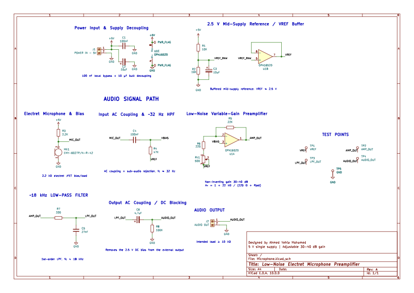
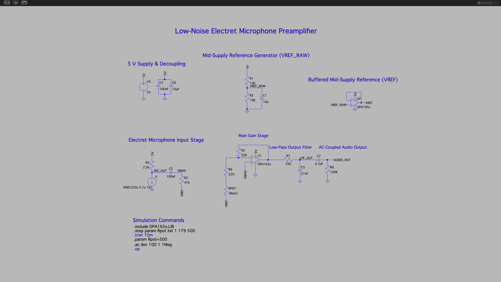
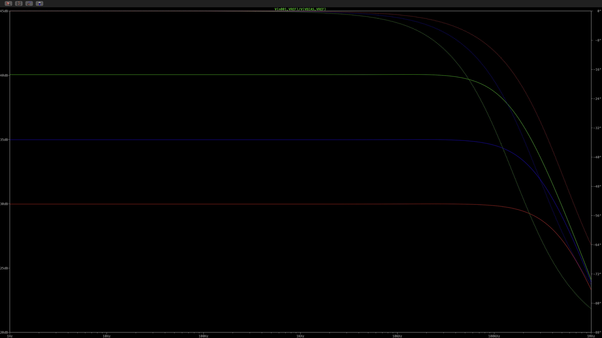
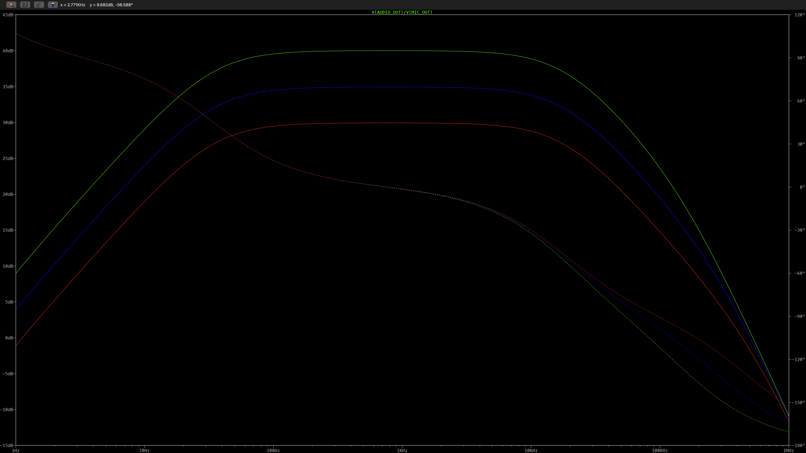
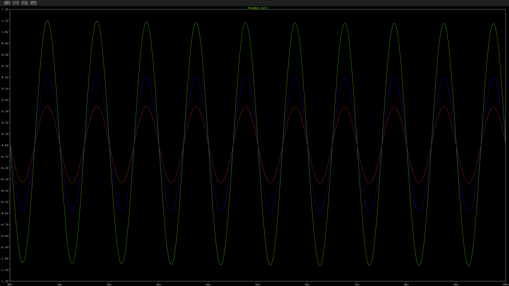
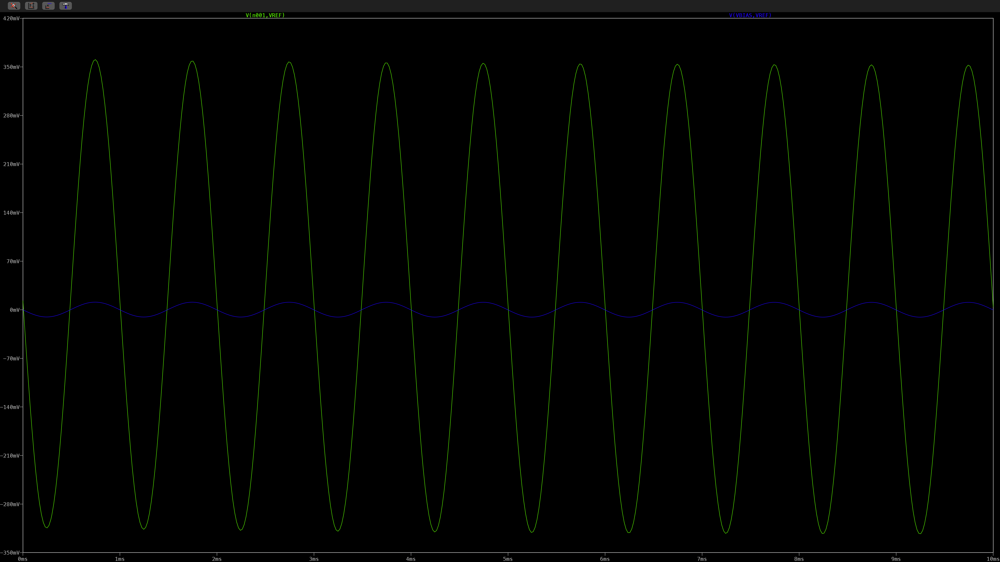
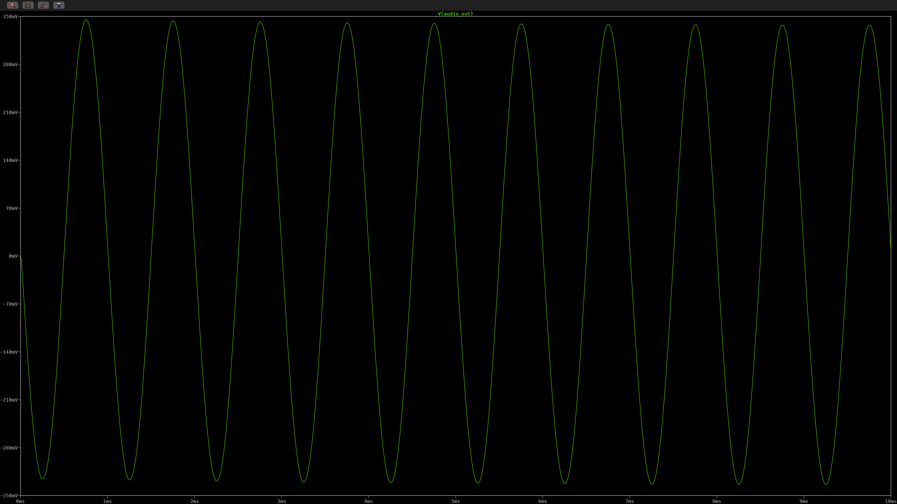

# Low-Noise Electret Microphone Preamplifier

A 5 V single-supply electret microphone preamplifier designed in KiCad and validated in LTspice. The design provides adjustable gain of approximately 30–40 dB and audio-band filtering, with a simulated -3 dB bandwidth of approximately 33.9 Hz to 17.8 kHz at the 30 dB setting.


### Quick links

- [KiCad schematic](hardware/kicad/Microphone.kicad_sch)
- [KiCad PCB](hardware/kicad/Microphone.kicad_pcb)
- [LTspice simulation](simulation/ltspice/)
- [Noise analysis notes](docs/noise-analysis.md)

## Project status

- Circuit design: complete
- KiCad schematic and PCB: complete
- PCB DRC: **0 errors, 0 warnings, 0 unconnected items**
- LTspice `.op`: passes
- LTspice transient analysis: passes
- LTspice stepped transient analysis: passes
- LTspice stepped AC analysis: passes
- Hardware measurement: pending
- Full system noise characterization: pending

## Key specifications

| Parameter | Design / simulated result |
| --- | --- |
| Supply voltage | 5 V DC |
| Input | Electret microphone |
| Op-amp | OPA1652 dual FET-input audio op-amp |
| Gain range | Approximately 30–40 dB |
| Validated gain points | Approximately 30 / 35 / 40 dB |
| Simulated -3 dB bandwidth at ~30 dB gain | Approximately 33.9 Hz to 17.8 kHz |
| PCB | 2-layer, approximately 60 mm × 40 mm |
| Ground strategy | Bottom-layer GND plane |

## Architecture

**Electret microphone → AC coupling / bias → non-inverting OPA1652 gain stage → low-pass filter → output coupling → audio output**

The second amplifier inside the dual OPA1652 is used as a buffer for the mid-supply reference.

### Electret microphone input

The input uses an **EKULIT EMY-6027P/N-R-42** electret capsule biased from the 5 V rail through **R3 = 2.2 kΩ**.

The microphone signal is AC-coupled through **C4 = 100 nF** into the amplifier bias node. A project-local KiCad footprint is included at:

`hardware/kicad/AudioPreamp.pretty/Microphone_EKULIT_EMY-6027PNR-42.kicad_mod`

### Buffered mid-supply reference

Because the amplifier operates from a single 5 V supply, the signal path is referenced to approximately 2.5 V.

- **R1 = 10 kΩ**
- **R2 = 10 kΩ**
- **C3 = 10 µF**

R1 and R2 generate `VREF_RAW`, and the second OPA1652 channel buffers it to create the low-impedance `VREF` node.

### Variable-gain amplifier

The first OPA1652 channel is configured as a non-inverting amplifier referenced to `VREF`.

- **R5 = 22 kΩ**
- **R6 = 220 Ω**
- **RV1 = 500 Ω**

The approximate gain is:

$$
A_v = 1 + \frac{R_5}{R_6 + R_{V1}}
$$

Changing the effective resistance of RV1 gives the intended approximately **30–40 dB** adjustment range. LTspice validation was performed at approximately **30 dB, 35 dB, and 40 dB**.

### High-pass filtering

The input coupling network uses:

- **C4 = 100 nF**
- **R4 = 47 kΩ**

The nominal component-value calculation is:

$$
f_{HP} = \frac{1}{2\pi R_4 C_4} \approx 33.9\,\text{Hz}
$$

The **~32 Hz** label shown on the KiCad schematic is an approximate design annotation; the nominal RC calculation and simulated lower -3 dB point are approximately **33.9 Hz**.

### Low-pass filtering

The gain-stage output feeds a first-order RC low-pass filter:

- **R7 = 330 Ω**
- **C5 = 27 nF**

Its nominal corner frequency is:

$$
f_{LP} = \frac{1}{2\pi R_7 C_5} \approx 17.9\,\text{kHz}
$$

This closely matches the simulated upper -3 dB point of approximately **17.8 kHz**.

### Output coupling

**C6 = 4.7 µF** AC-couples the filtered signal to `AUDIO_OUT`, removing the internal 2.5 V DC bias. **R8 = 100 kΩ** provides the output-side DC reference to ground.

## Power decoupling

The 5 V rail uses:

- **C1 = 100 nF** local bypass
- **C2 = 10 µF** bulk decoupling

The mid-supply divider also uses **C3 = 10 µF** at `VREF_RAW`.

## Noise status

The OPA1652 was selected partly for its low-noise audio performance. Texas Instruments specifies typical input-voltage noise density of **4.5 nV/√Hz at 1 kHz** and **3.8 nV/√Hz at 10 kHz**.

That device specification is not the same as total preamplifier noise. The complete system also includes noise from the electret capsule and its internal JFET, bias and feedback resistors, the VREF network, the power supply and the PCB environment.

The current project therefore does **not** claim a measured system noise figure. A first-order resistor/noise-source discussion and the planned hardware characterization method are documented in [`docs/noise-analysis.md`](docs/noise-analysis.md).

## KiCad schematic



The complete editable schematic is committed at [`hardware/kicad/Microphone.kicad_sch`](hardware/kicad/Microphone.kicad_sch). Open the project through [`hardware/kicad/Microphone.kicad_pro`](hardware/kicad/Microphone.kicad_pro) in KiCad 10 or a compatible newer release.

## PCB design

The board was designed in KiCad 10 as a two-layer PCB.

Notable layout features:

- Bottom-layer GND copper plane
- 0603 resistors and ceramic capacitors
- SOIC-8 OPA1652
- Through-hole electret microphone
- Through-hole gain potentiometer
- Screw-terminal power and audio-output connectors
- Dedicated test points for `VREF`, `AMP_OUT`, `LPF_OUT`, `AUDIO_OUT`, and `GND`
- Project-local microphone footprint library for portability

## PCB views

### Alternate 3D view


### Routed PCB layout


## LTspice validation

The final simulation passed:

- `.op`
- transient analysis
- stepped transient analysis
- stepped AC analysis

The stepped simulations confirm the intended approximately **30 / 35 / 40 dB** gain settings.

At approximately 30 dB gain, the simulated -3 dB bandwidth is:

- **Lower cutoff:** 33.9 Hz
- **Upper cutoff:** 17.8 kHz

## Simulation plots

### LTspice schematic



### Stepped gain response



### Full frequency response



### Stepped transient response



### Input versus output at approximately 30 dB



### Final AC-coupled audio output



## Repository structure

```text
.
├── README.md
├── .gitignore
├── .gitattributes
├── hardware/
│   └── kicad/
│       ├── Microphone.kicad_pro
│       ├── Microphone.kicad_sch
│       ├── Microphone.kicad_pcb
│       ├── sym-lib-table
│       ├── AudioPreamp.kicad_sym
│       ├── fp-lib-table
│       └── AudioPreamp.pretty/
│           └── Microphone_EKULIT_EMY-6027PNR-42.kicad_mod
├── simulation/
│   └── ltspice/
│       ├── Microphone.asc
│       └── README.md
└── docs/
    ├── noise-analysis.md
    ├── kicad/
    └── ltspice/
```

Generated Gerber, drill, cache, autosave, backup, and local KiCad preference files are intentionally excluded from version control.

## Opening the KiCad project

1. Install KiCad 10 or a compatible newer release.
2. Clone or download the repository.
3. Open `hardware/kicad/Microphone.kicad_pro`.

The project-local OPA1652 symbol library and microphone footprint library are referenced using `${KIPRJMOD}`, so no user-specific path should need to be repaired. Standard KiCad footprints and 3D models require the normal KiCad standard libraries.

## Opening the LTspice simulation

The final LTspice schematic file is:

`simulation/ltspice/Microphone.asc`

The simulation uses Texas Instruments' **OPA165x PSpice Model (Rev. C)**. The vendor model is intentionally not redistributed in this repository. Download it from the official TI OPA1652 product page and place `OPA165x.LIB` beside `Microphone.asc`.

See [`simulation/ltspice/README.md`](simulation/ltspice/README.md) for the exact setup, directives, and useful trace expressions.

## Current validation boundary

The published performance figures are **simulation results**, not bench measurements. Hardware characterization will be added after PCB assembly and testing, including measured gain, frequency response, noise, clipping level and supply current.
