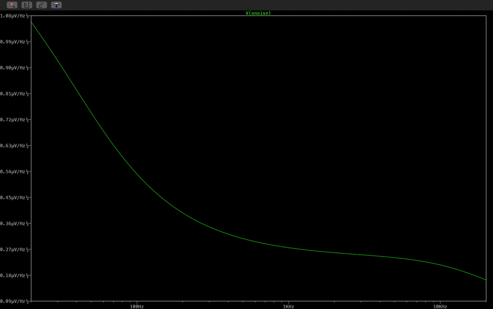

# Noise analysis notes

The final PCB uses an **Analog Devices AD8656ARMZ** dual op-amp. The complete preamplifier has **not yet been characterized for total input-referred or output noise**. This note separates individual noise sources and earlier-model references from system-level performance claims.

## Earlier OPA1652 reference (not the final device)

The earlier design and LTspice simulation used an OPA165x model. Texas Instruments specifies the OPA1652 typical input-voltage noise density as:

- **4.5 nV/√Hz at 1 kHz**
- **3.8 nV/√Hz at 10 kHz**
- **4.0 µVpp from 20 Hz to 20 kHz**

Source: TI OPA165x datasheet (SBOS477B).

These specifications apply **only to the earlier OPA1652**. They must not be attributed to the final AD8656. AD8656-specific noise estimates require its own device specifications and the complete signal-chain transfer functions.

## Resistor thermal-noise context

At approximately 25 °C, the Johnson-noise density of a resistor is:

$$
e_n = \sqrt{4 k T R}
$$

For several resistors used in the signal path, the individual thermal-noise densities are approximately:

| Component / value | Thermal-noise density |
| --- | ---: |
| R4 = 47 kΩ | 27.8 nV/√Hz |
| R5 = 22 kΩ | 19.0 nV/√Hz |
| R3 = 2.2 kΩ | 6.0 nV/√Hz |
| R6 = 220 Ω | 1.9 nV/√Hz |
| R7 = 330 Ω | 2.3 nV/√Hz |

These values are **individual resistor noise densities only**. They cannot simply be added directly to obtain total preamplifier noise because each source is shaped by a different transfer function and impedance.

## Important system noise sources

A complete noise budget must include at least:

- electret capsule and its internal JFET
- microphone-bias resistor and source impedance
- R4 input-bias resistor
- AD8656 input-voltage and input-current noise
- gain-setting feedback network
- VREF generation and buffer noise
- power-supply noise and coupling
- PCB leakage, grounding and external interference

The electret capsule itself can dominate the practical noise floor, so op-amp noise alone is not sufficient to describe system performance.

## Current claim boundary

The term **low-noise** in this project currently refers to the design intent. It does **not** mean that a complete system noise figure has already been measured.

The repository now documents **user-run AD8656-based LTspice gain, frequency-response, transient and output-noise spectra**. An earlier OPA165x simulation is retained separately for development history. Final PCB hardware has not yet been measured for gain, bandwidth or noise.

## AD8656 simulated output-noise spectrum



With `Rpot=500 Ω`, the user ran:

```text
.noise V(audio_out) I1 dec 100 20 20k
```

The `V(onoise)` trace plots simulated **output-noise amplitude spectral density (V/√Hz)** across 20 Hz–20 kHz. It reflects the simulated components and the AD8656 macro-model's implemented noise sources. The microphone is represented by an ideal current source, **not a physical electret capsule noise model**. The spectral-density graph alone does not establish an integrated RMS value, input-referred noise, microphone self-noise, or a hardware noise floor.

A separate user-run LTspice measurement integrated the simulated output noise:

```text
.meas NOISE Output_Noise_RMS INTEG V(onoise) FROM=20 TO=20k
output_noise_rms: INTEG(v(onoise))=3.18777e-05 FROM 20 TO 20000
```

This gives **31.8777 µV RMS (approximately 31.88 µV RMS)** at `AUDIO_OUT` over **20 Hz–20 kHz**, with **Rpot = 500 Ω**. This result depends on the electrical circuit's modeled noise sources, including the AD8656 SPICE macro-model, but excludes the real capsule's complete self-noise. It must not be reported as measured PCB noise, real-microphone system noise or a measured signal-to-noise ratio.

## Planned characterization

After assembly, the useful measurements are:

1. Verify the 5 V supply and buffered mid-supply reference; short or terminate the signal input in a documented, controlled configuration for noise testing.
2. Measure output RMS noise over a defined audio bandwidth.
3. Repeat at the approximately 30 dB, 35 dB and 40 dB gain settings.
4. Refer the measured output noise back to the input using the measured gain.
5. Measure the microphone-connected noise separately from the amplifier-only condition.
6. Compare measured results with an AD8656-specific analytical or SPICE noise budget, where the device models support meaningful noise data.

Any future noise number should always state the **bandwidth, gain setting, input condition, instrument and measurement method**. Calculated, simulated and measured values should be labeled separately.
